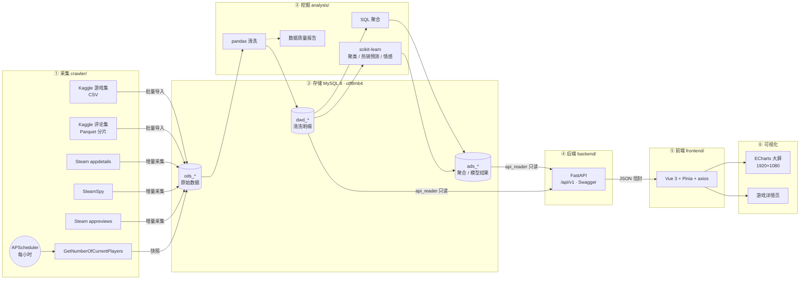
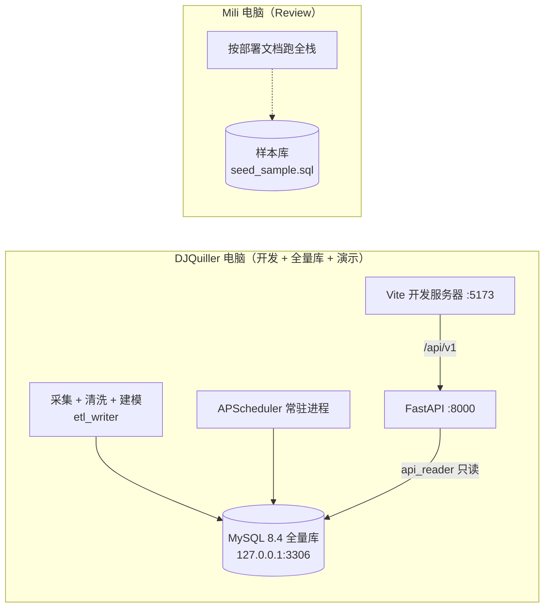
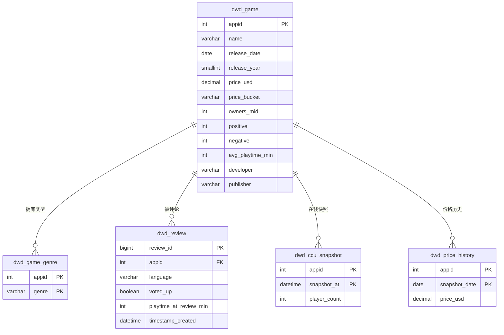

# Steam 平台游戏玩家生态与热销趋势可视化系统 —— 技术方案与架构设计文档（M2）

| 项 | 内容 |
|---|---|
| 小组成员 | 成员 A：DJQuiller（开发，负责全部六个环节）；成员 B：Mili（Review） |
| 文档版本 | v1.0（M2 架构评审） |
| 相关契约 | 表结构 `docs/schema.md`（v0.2）、接口 `docs/api.md`（v0.2）、数据来源 `docs/data-sources.md` |

---

## 1. 项目背景与目标

### 1.1 问题定义

Steam 是全球最大的 PC 游戏发行平台，上架游戏已超过 10 万款。面对这样的规模，开发者和玩家都想知道三件事：

1. **市场在怎么变**：每年发行多少游戏？哪些类型在升温？价格和口碑有没有关系？
2. **玩家在想什么**：评论来自哪些语言区？玩家玩多久才写评论？一周里什么时候最活跃？
3. **什么游戏会火**：能否只凭发行前就知道的信息（价格、类型、平台、语言……）预测一款游戏能否成为热销作品？

本系统围绕这三个问题，搭建从数据采集到大屏展示的完整流水线。大屏按"**市场在变 → 玩家在想什么 → 什么游戏会火**"这条故事线组织。

### 1.2 目标与规模

| 指标 | 目标 | 依据 |
|---|---|---|
| 游戏数 | ≥ 8 万款（预计约 12–15 万） | Kaggle 游戏集 README 称 148,909 款 |
| 评论数 | ≥ 100 万条（实际全量约 1.21 亿条元数据） | Kaggle 评论集说明：121,312,346 条，截至 2026-10-30 |
| 在线人数快照 | Top 游戏每小时一次，持续积累 | 定时任务调用 Steam Web API |
| 数据质量 | 输出《数据质量报告》 | `analysis/reports/data_quality.md` |

**"海量"体现在哪里**：评论明细达到**亿级**（1.21 亿条），覆盖十几万款游戏，不可能每次请求都现场扫一遍。因此系统采用**数仓分层 + 离线预聚合**：上亿行明细由数据库预先聚合成每张几百到几万行的 `ads` 小表，前端每次请求只查这些小表，响应在百毫秒级。

---

## 2. 系统架构

### 2.1 总体架构（六环节）



两侧的分界线在数据库：数据侧（采集、清洗、建模）用 `etl_writer` 账号写 `ods`/`dwd`/`ads` 三层；可视化侧的后端用 `api_reader` 账号，只读 `dwd`/`ads`。两侧只通过两份契约文件交接，表结构以 `docs/schema.md` 为准，接口以 `docs/api.md` 为准。虽然两侧由同一人开发，这条边界照样保留：写入与只读分离，任何一侧改动都不会越过契约影响另一侧。

### 2.2 数据分层

| 层 | 内容 | 写入方 | 说明 |
|---|---|---|---|
| `ods_*` | 原始数据原样落库 | 采集脚本 | 保留可追溯性；写入用 `INSERT … ON DUPLICATE KEY UPDATE`，可重复执行 |
| `dwd_*` | 清洗后的明细 | pandas 清洗 | 统一货币、价格区间、年份、时间（UTC），类型拆成多行 |
| `ads_*` | 每个看板模块一张聚合表，另有模型结果表 | SQL 聚合与模型脚本 | 保留"年份 / 类型 / 价格区间"三个维度，供后端过滤后汇总 |

### 2.3 部署与网络



- **开发**：全量库、采集定时任务、后端和前端都在同一台电脑上运行；MySQL 只监听本机，不对外开放端口。
- **Review**：Mili 克隆仓库、导入 `storage/sample/seed_sample.sql` 样本库后，即可按部署文档在自己电脑上跑起全栈；`.env` 中的 `DB_HOST` 用来切换样本库与全量库。
- **答辩演示**：在本机用全量库现场运行全部服务，不依赖网络；用 `mysqldump --default-character-set=utf8mb4` 定期备份全量库。

---

## 3. 技术选型对比与理由

### 3.1 采集层

| 方案 | 优点 | 缺点 | 结论 |
|---|---|---|---|
| **requests / httpx + 自研客户端** | 数据源都是 JSON API，不需要解析页面；限速、重试、断点续采可以按每个 API 的限制单独控制 | 并发、重试需要自己写 | ✅ 采用 |
| Scrapy | 自带调度和中间件 | 主要为 HTML 爬取设计；本项目以 API 为主，引入后反而增加复杂度 | 不采用 |
| Selenium | 能处理动态渲染页面 | 所需数据都有现成 API，用不上 | 不采用 |

**定时增量采集**：用 APScheduler 每小时采集 Top 游戏的在线人数，每天采集一次价格快照，实现"定时增量采集"加分项。Top 游戏取历史峰值在线最高的 500 款与拥有者最多的 500 款的并集，大约 600–800 款。

### 3.2 存储层

| 方案 | 优点 | 缺点 | 结论 |
|---|---|---|---|
| **MySQL 8** | 团队熟悉；支持窗口函数和 CTE；亿行级明细配合聚簇主键与离线预聚合够用（明细只在离线阶段扫描）；部署简单 | 列式聚合性能不如 OLAP 库 | ✅ 采用 |
| PostgreSQL | 分析函数更丰富 | 团队不熟，收益有限 | 不采用 |
| ClickHouse | 亿级聚合很快 | 多一套运维；聚合已离线预计算，查询性能不是瓶颈 | 作为扩展方向：若离线聚合耗时成为瓶颈再引入 |
| SQLite | 零配置 | 没有账号与权限体系，无法让后端只读；大批量写入和聚合性能弱 | 不采用 |

**核心设计**：重计算都放到离线阶段，提前写进 `ads` 小表；后端只做过滤、`SUM … GROUP BY` 再汇总、排序和分页。这样亿级明细不会拖慢接口。字符集统一用 `utf8mb4`，因为评论中有大量 emoji。

### 3.3 挖掘层

| 方案 | 优点 | 缺点 | 结论 |
|---|---|---|---|
| **pandas + numpy + scikit-learn** | 课程要求的主线；单机即可处理；生态成熟 | 单机内存有上限 | ✅ 采用。评论集分块读取（`chunksize`） |
| Spark | 适合分布式计算 | 评论集已是列式 Parquet 分片，单机逐片只读所需列即可处理 1.21 亿行；引入集群成本过高 | 不采用 |

| 模型 | 方法 | 选型理由 |
|---|---|---|
| 游戏聚类 | KMeans；特征为价格、好评率、log(拥有者)、平均时长，先标准化；用 PCA 降到二维供散点图展示 | 结果可解释，便于给每个簇贴业务标签（如"爆款大作 / 小众精品 / 免费引流"）；K 在 3–8 之间用肘部法和轮廓系数选取 |
| 热销预测 | RandomForest 与 LogisticRegression 对比 | LR 作为可解释的基线，RF 能捕捉非线性和特征交互；用 F1、AUC 对比，满足"模型调优与对比"加分项 |
| 评论情感 | TF-IDF + LogisticRegression，用 `voted_up` 作为标签 | 不需要人工标注，训练快；时间不够时降级为直接统计 `voted_up` |

**热销标签与防止标签泄露**：拥有者估算中值排在前 10% 的游戏记为"热销"。特征**只用发行前就能知道的信息**，即价格、类型、平台、语言数、DLC 数、成就数、年龄限制、开发商历史作品数。好评数、在线人数这类发行后才有的指标与拥有者高度相关，放进特征等于提前泄露答案，因此一律不用。

### 3.4 后端

| 方案 | 优点 | 缺点 | 结论 |
|---|---|---|---|
| **FastAPI** | 用 pydantic 校验参数并定义响应模型；自动生成 Swagger 接口文档（加分项）；性能好 | — | ✅ 采用 |
| Flask | 轻量、资料多 | 参数校验、接口文档都要靠插件补 | 不采用 |

配套组件：SQLAlchemy（参数化 SQL，防注入）、pydantic-settings（从 `.env` 读配置，密钥不进代码）、pytest（每个接口覆盖正常、空数据、非法参数三种情况）。

### 3.5 前端与可视化

| 方案 | 优点 | 缺点 | 结论 |
|---|---|---|---|
| **Vue 3 + Vite + TypeScript** | 组件化，适合十几个图表的大屏；Pinia 统一管理全局筛选状态；中文资料多 | — | ✅ 采用（组件化加分项） |
| React | 生态大 | 团队更熟 Vue | 不采用 |
| 原生 HTML + JS | 课程的最低要求 | 图表多、联动复杂时难以维护 | 不采用 |

| 图表库 | 优点 | 缺点 | 结论 |
|---|---|---|---|
| **ECharts 5** | 内置树图、箱线图、热力图、动态排序条形图；支持注册主题、图表联动事件 | — | ✅ 采用 |
| D3 | 定制能力最强 | 每种图表都要从头写，工作量过大 | 不采用 |

---

## 4. 数据模型

完整字段与口径以 `docs/schema.md` 为准，这里只列出结构和关键设计。

### 4.1 明细层 ER 图



### 4.2 全局口径

| 口径 | 约定 |
|---|---|
| 货币 | 美元，`DECIMAL(10,2)`，免费游戏价格为 0 |
| 价格区间 | `free` / `lt10` / `10_30` / `30_60` / `ge60` |
| 好评率 | `positive / (positive + negative)`；评论数不足 10 条的游戏不参与统计 |
| 拥有者 | SteamSpy 区间估算取中值 |
| 时间 | 统一存 UTC，热力图上注明"UTC" |
| 字符集 | `utf8mb4` / `utf8mb4_0900_ai_ci` |

### 4.3 聚合层设计要点

- **一个看板模块对应一张 `ads` 表**，共 15 张：13 张对应大屏和详情页的接口，`ads_model_metrics` 供答辩展示，`ads_meta` 记录数据更新时间和各表行数。表与接口的对应关系见 `docs/schema.md`。
- **筛选维度**：需要响应筛选的表都保留 `release_year`、`genre`、`price_bucket` 三列。
- **多类型去重**：一款游戏可能同时属于多个类型，直接按类型求和会重复计数。因此聚合表另外预计算一组 `genre='__ALL__'` 的汇总行；后端在没选类型时只读汇总行，选了类型时只读该类型的行。游戏粒度的表（Top10、聚类）每款游戏只有一行，按类型筛选时关联 `dwd_game_genre`。
- **分位数不能跨组相加**：箱线图不预存分位数，只预存 1% 宽度的好评率分箱计数。分箱计数可以相加，后端按筛选条件求和后，从累计分布读出五数，任意筛选组合都能精确到 1 个百分点。这张表同时供好评率直方图使用。
- **评论原文**：1.21 亿条评论只入库元数据，不存原文，以控制体积（原文约占源文件的大部分）。情感模型需要原文，所以每款游戏最多抽 30 条评论保留原文，实测共 2,335,697 条、覆盖 124,757 款游戏，单独成表。
- **隐私**：评论者的哈希 ID 不入库，大屏不展示评论原文。

---

## 5. API 清单

完整定义见 `docs/api.md`，运行时以 FastAPI 自动生成的 Swagger 页面（`/docs`）为准。

**返回信封**：`{ "code": 0, "msg": "ok", "data": … }`

| code | 含义 |
|---|---|
| `0` | 成功；结果为空时也返回 0，`data` 为空数组或空对象 |
| `40001` | 参数错误 |
| `40401` | 资源不存在 |
| `50001` | 数据库异常 |

**全局筛选参数**（全部可选）：`year_start`、`year_end`、`genre`、`price_bucket`（可多选，逗号分隔）。

| 接口（前缀 `/api/v1`） | 可筛选 | 用途 |
|---|---|---|
| `GET /meta/filters` | | 筛选项 |
| `GET /meta/updated-at` | | 数据更新时间 |
| `GET /overview/kpi` | | 4 个 KPI |
| `GET /trend/yearly` | ✓ | 历年发行量与均价 |
| `GET /trend/genres` | ✓ | 类型热度 |
| `GET /trend/price-rating` | ✓ | 价格区间 × 好评率箱线图 |
| `GET /rank/top-sellers` | ✓ | 热销 Top10（可按拥有者或在线人数排序） |
| `GET /rank/online-live` | | 实时在线榜 |
| `GET /cluster/games` | ✓ | 聚类散点 |
| `GET /ecosystem/rating-dist` | ✓ | 好评率分布 |
| `GET /ecosystem/review-languages` | ✓ | 评论语言分布 |
| `GET /ecosystem/playtime-dist` | ✓ | 游玩时长分布 |
| `GET /ecosystem/activity-heatmap` | ✓ | 星期 × 小时评论活跃度 |
| `GET /games/{appid}` | | 游戏详情（含预测、情感、聚类标签） |
| `GET /games/{appid}/reviews-trend` | | 月度评论走势 |
| `GET /games/{appid}/price-history` | | 价格历史 |

**异常与降级**：参数校验失败返回 `40001`；数据库异常记录日志后返回 `50001`。前端统一处理加载中、空数据、报错三种状态；接口失败时弹出提示，并继续显示上一次成功取到的数据。

---

## 6. 可视化设计

### 6.1 大屏布局（1920×1080，等比缩放）

```
┌───────────────────────────────────────────────────────────────────────┐
│  标题  │  全局筛选：年份 / 类型 / 价格区间（多选）  │  数据更新时间     │
├───────────┬───────────┬───────────┬───────────────────────────────────┤
│ 游戏总数  │ 评论总数  │ 估算玩家  │ 实时在线峰值          （翻牌 KPI）│
├───────────────────┬───────────────────────────┬───────────────────────┤
│ 左·市场在变       │ 中·什么游戏会火           │ 右·玩家在想什么       │
│ 历年发行量与均价  │ 热销 Top10（动态排序）    │ 好评率分布（直方图）  │
│ 类型热度（树图）  │ 实时在线榜（60 秒轮询）   │ 评论语言（条形图）    │
│ 价格 × 好评率     │ 游戏聚类（散点图）        │ 游玩时长（直方图）    │
│ （箱线图）        │                           │ 活跃时段（热力图）    │
└───────────────────┴───────────────────────────┴───────────────────────┘
          点击 Top10 条目或散点 → 跳转详情页 /game/:appid
```

### 6.2 交互链路

1. **全局筛选**：筛选状态统一存放在 Pinia；筛选条件一变，所有可筛选的图表重新请求数据。
2. **图表联动**：点击类型树图的某一块，就把该类型写入全局筛选，其他图表随之过滤；再次点击或点"重置"即取消。
3. **下钻**：点击 Top10 条目或聚类散点，进入该游戏的详情页，查看基本信息、聚类标签、热销预测、情感占比、评论走势、价格历史和同类对比。

### 6.3 图表选型理由

| 图表 | 选用 | 理由 |
|---|---|---|
| 历年发行量与均价 | 柱线双轴 | 数量与价格单位不同，共用时间轴 |
| 类型热度 | 矩形树图 | 类型有 20 多个，饼图分不清；树图的面积能直观反映份额 |
| 价格 × 好评率 | 箱线图 | 比较的是各价格区间的好评率分布，不只是平均值 |
| 热销 Top10 | 动态排序条形图 | 切换排序口径时有动画过渡 |
| 聚类 | 散点图 | PCA 二维坐标，颜色表示所属簇 |
| 评论语言 | 条形图 | 语言超过 5 种，不用饼图 |
| 活跃时段 | 热力图 | 星期 × 小时两个维度 |

**视觉规范**：统一采用 Steam 深色科技蓝主题，设计 token 见 `frontend/CLAUDE.md`。每个图表标题旁都注明单位和口径，例如"拥有者（SteamSpy 区间估算中值）""时间（UTC）"。大屏不用地图，评论的地域构成用语言分布表示，从而规避地图审图合规问题。

---

## 7. 计划安排

| 阶段 | 学时 | 数据侧 | 可视化侧 | 里程碑交付 |
|---|---|---|---|---|
| M2 方案设计 | 17–18 | 选定数据集，确定热销标签；修订表结构契约 | 修订接口契约，撰写本文档 | 本文档 |
| 环境搭建 | 19–20 | 安装 MySQL，建库建表，分配账号；下载 Kaggle 数据；**启动在线人数定时采集** | 搭建 FastAPI 和 Vue 项目骨架，实现主题、缩放容器和 `BaseChart` | 主库与样本库均可连通 |
| 采集与清洗 | 21–24 | 将 Kaggle 数据导入 `ods`；实现增量采集；清洗到 `dwd`；导出样本库 | 基于样本库开发前 6 个接口和对应图表 | — |
| **M3 中期检查** | 25–26 | 打通采集 → 存储；出数据质量报告初稿 | 大屏初版，接入真实接口 | 可运行原型、进度报告、问题清单 |
| 聚合与建模 | 27–30 | 生成全部 `ads` 表；完成聚类、热销预测、情感模型 | 完成剩余接口、联动、下钻和详情页；补全 pytest | — |
| 联调与整改 | 31–34 | 全量数据刷新；数据质量报告定稿 | 中期意见整改，性能与异常测试；写部署文档 | 部署包、录屏 |
| **M4 最终答辩** | 35–36 | DJQuiller 制作 PPT；两人共同排练演示 | | 源码、部署包、PPT、现场演示 |

**进度（截至 2026-11-12）**

- [x] 选定数据集，确定热销标签，修订表结构契约与接口契约
- [x] 安装 MySQL，建库建表，分配两个账号
- [x] 下载 Kaggle 数据并导入 `ods`：游戏 125,855 行，评论 121,312,346 行（13 个分片）
- [x] 清洗到 `dwd`：游戏 125,854 款，评论 121,312,346 条，无丢弃
- [x] 评论原文按游戏分层抽样：2,335,697 条，覆盖 124,757 款游戏
- [x] 申请 Steam Web API Key
- [ ] 启动在线人数定时采集
- [ ] 增量采集（`appdetails`、SteamSpy）
- [ ] 导出样本库
- [ ] 数据质量报告初稿
- [ ] 生成 `ads` 表（游戏侧聚合已写好，等 Review；评论侧与模型未开始）
- [ ] 搭建 FastAPI 和 Vue 项目骨架

实际占用约 33 GB（`ods` 约 20 GB，`dwd` 约 13 GB）；评论导入、抽样、清洗累计约 2.2 小时，不含下载。

**关键路径与可并行的部分**
- **在线人数快照必须尽早开始**：快照要连续积累多天，才能画出趋势、展示"持续增量"。所以采集脚本在环境搭建阶段就要部署，不能等到最后。
- **评论数据量最大**：1.21 亿行要逐片下载、导入、清洗，这一步预留 4 个学时，导入在后台运行。
- **两侧交替推进**：样本库导出之前，可视化侧先依据契约用假数据开发界面；样本库导出后立即切换到真实数据，最终演示不保留任何硬编码数据。

---

## 8. 分工表

| 环节 | 开发 | Review | 主要产出 |
|---|---|---|---|
| ① 采集 | 成员 A | 成员 B | `crawler/`：公共 HTTP 客户端、Kaggle 导入、增量采集、定时任务 |
| ② 存储 | 成员 A | 成员 B | `storage/`：建表 SQL、迁移脚本、样本库；`docs/schema.md` |
| ③ 挖掘 | 成员 A | 成员 B | `analysis/`：清洗、聚合、三个模型、数据质量报告 |
| ④ 后端 | 成员 A | 成员 B | `backend/`：FastAPI、筛选参数解析、pytest；`docs/api.md` |
| ⑤ 前端 | 成员 A | 成员 B | `frontend/`：Vue 工程、状态管理、路由、交互 |
| ⑥ 可视化 | 成员 A | 成员 B | 大屏布局、图表组件、主题与口径标注 |
| 文档与答辩 | 成员 A | 成员 B | 部署文档、README、PPT；两人都能讲清全链路 |

**分工说明**：六个环节的编码、建库、数据导入和文档全部由成员 A（DJQuiller）完成；成员 B（Mili）不参与编码，负责 Review 每一个 PR，批准后才能合并，并通过 Review 熟悉全链路的关键设计，答辩时同样能讲清。实际贡献以 Git 提交和 PR Review 记录为准。

**协作流程**：`main` 分支受保护，开发在 `feat/<模块>-<描述>` 分支上进行，每个 PR 都须经成员 B Review 批准后才能合并；提交信息遵循 Conventional Commits 规范；修改契约同样走 PR，批准合并后才改代码或执行迁移。

---

## 9. 风险与对策

| 风险 | 影响 | 对策 |
|---|---|---|
| Steam / SteamSpy 接口限流 | 增量采集变慢 | 公共客户端统一限速和指数退避；断点续采；Kaggle 数据打底，保证规模达标不依赖实时采集 |
| 评论集来自第三方、下载量小 | 数据可信度受质疑 | 说明文件写明了采集接口和开源代码；导入后与游戏集里 Steam 官方的好评/差评总数对比，作为一致性校验写进数据质量报告 |
| 1.21 亿行评论导入慢、占空间 | 导入和聚合耗时长 | 逐片导入、只读需要的列、不存原文；用 `LOAD DATA` 批量导入；InnoDB 缓冲池调到 8 GB；先用 1 个分片实测耗时与占用，再跑全量 |
| 一人承担全部开发 | 工作量集中，进度可能滞后 | 在线人数快照、评论导入等耗时任务最先启动并在后台运行；样本库优先导出，前后端开发不被全量数据阻塞；每个里程碑前对照计划检查进度 |
| 全量库与演示依赖单台电脑 | 电脑故障时无法演示 | 定期用 `mysqldump` 备份全量库；录制不少于 3 分钟的演示录屏兜底 |
| 字符集或编码问题 | 评论乱码、写入失败 | 全链路使用 UTF-8 / `utf8mb4`（见根目录 `CLAUDE.md` 的"字符集"一节） |

---

## 10. 与评分要点的对应

| 评分维度 | 本方案中的对应设计 |
|---|---|
| 功能完整性 | 六个环节全部自研打通；三种错误码 + 前端三态 + 失败时保留旧数据 |
| 数据规模 | 亿级评论、十万级游戏；有数据质量报告；用数据库做预聚合 |
| 可视化效果 | 一条故事线贯穿；全局筛选、图表联动、下钻三层交互；统一主题；标注单位与口径；不使用地图 |
| 工程规范 | 分层目录；两份契约文件；Swagger 接口文档；pytest；`.env` 管理密钥；初始化脚本可重复执行 |
| 团队协作 | 分支、PR、Review 流程；成员 A 开发、成员 B Review，分工表如实记录 |
